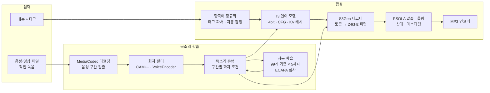

# 🎙️ KoreanVoice

**휴대폰 안에서만 동작하는 한국어 감정 음성 합성 · 목소리 복제 앱**

목소리 파일이나 영상 하나로 그 사람의 목소리를 학습하고, 최대 10만 자의 대본을 감정을 실어 읽어 MP3로 만듭니다.
모델을 한 번 받은 뒤에는 **인터넷 연결도, 유료 API도, 서버도 쓰지 않습니다.**

[**⬇️ APK 내려받기**](release/KoreanVoice-lite.apk) · [주요 기능](#-주요-기능) · [구조](#%EF%B8%8F-구조) · [엔지니어링](#-엔지니어링-하이라이트) · [검증 결과](#-검증-결과) · [English](#english-summary)

---

## 💡 만든 이유

음성 합성 서비스는 대부분 클라우드 API입니다. 글자 수만큼 돈을 내야 하고, 내 목소리 녹음을 남의 서버에 올려야 합니다.
이 프로젝트의 목표는 **"휴대폰 한 대로, 무료로, 내 목소리를 밖으로 내보내지 않고"** 사람이 읽은 것 같은 한국어 낭독을 만드는 것이었습니다.

그래서 연구용 음성 모델(Chatterbox Multilingual, 약 5억 파라미터)을 **ONNX로 직접 변환하고 4비트로 압축**해 휴대폰에서 돌렸고,
그 위에 목소리 학습, 감정 연출, 자동 학습, 긴 글 처리, MP3 인코딩까지 **전부 Kotlin으로 기기 안에** 구현했습니다.

## ✨ 주요 기능

| | 기능 | 설명 |
|---|---|---|
| 🗣️ | **목소리 학습** | 음성 파일(mp3·m4a·wav·flac…), **영상(mp4·mkv·webm…)**, 구글 드라이브 파일, 직접 녹음. 영상은 소리만 뽑아 말하는 구간을 자동으로 찾고, 다른 사람 목소리와 잡음 구간은 걸러 냅니다. |
| ➕ | **추가 학습** | 이미 만든 목소리에 자료를 계속 더해 점점 닮게 만듭니다. |
| 🤖 | **자동 학습 모드** | 99가지 기준(음높이·말투·말끝·울림·배경 등)으로 여러 방식을 시도해 원본과 가장 닮은 설정을 찾고, 그 결과로 다시 학습하기를 5세대 반복합니다. 세대별 결과를 들어 보고 골라 쓸 수 있습니다. |
| 🎭 | **감정 연출** | 감정 10종 + 강도, 문장별 자동 감정(대사는 진하게, 서술은 절제), 감정에 맞는 원본 구간을 골라 참조합니다. |
| 🏷️ | **부분 지정 태그** | `[기쁨:강]` `[속도:1.2]` `[높이:-2]` `[쉼:1.5]` `[말끝:올림]` `[울림:성당]` `[전화]` `{NASA\|나사}`처럼 대본 안에서 부분마다 지정합니다. |
| 🎚️ | **효과** | 울림 8종, 상태 8종(전화·라디오·속삭임·물속…), 배경음(말할 때 자동으로 작아지는 더킹), 방송용 마스터링, 발음 사전. |
| 📝 | **대본 편집기** | 키보드 바로 위에 붙는 태그 버튼 줄, 선택한 부분만 태그로 감싸기, 실행 취소, 선택 부분·문단 바로 듣기. |
| 📚 | **긴 글** | 최대 **100,000자**를 백그라운드에서 생성하고 64~192kbps **MP3**로 저장합니다. 중간에 멈춰도 끝난 문장부터 이어서 합니다. |

## 🏗️ 구조

- **추론**: ONNX Runtime(Android, CPU). T3 언어 모델은 4비트(MatMulNBits)로 압축했고, 분류기 없는 가이던스(CFG)·KV 캐시·정렬 감시기는 Kotlin으로 직접 구현했습니다.
- **모델 배포**: APK에는 16MB만 담고, 모델(약 1.1GB)은 처음 실행할 때 48MB 이하 조각으로 받아 **SHA-256으로 하나하나 검증**합니다. 끊겨도 조각 단위로 이어 받습니다.
- **앱**: Kotlin · Jetpack Compose · 포그라운드 서비스(화면이 꺼져도 생성·학습이 계속되고, 알림으로 진행률을 보여 줌).

## 🔧 엔지니어링 하이라이트

**1. 연구용 PyTorch 모델을 휴대폰용 ONNX로**
- 생성 루프를 쪼개 언어 모델(T3)·조건 인코더·디코더(S3Gen)·화자 인코더를 따로 내보내고, 샘플링·CFG·정렬 검사는 Kotlin으로 다시 짰습니다.
- 디코더의 무작위 노이즈를 고정해 **같은 입력이면 같은 소리**가 나오게 만들어, 원본 Python과 숫자로 비교할 수 있게 했습니다(아래 검증 결과).

**2. 메모리: 목소리 학습 중 최대 1.9GB → 0.8GB**
- 사용자 휴대폰에서 학습을 시작하면 앱이 꺼진다는 보고를 받고 메모리를 단계별로 측정했습니다. 학습에 쓰지 않는 합성 모델(약 1GB)까지 미리 불러오고 있었고,
  ONNX Runtime이 fp16 토크나이저의 가중치를 fp32로 미리 변환해 **250MB가 600MB로** 불어나 있었습니다.
- 모델은 쓸 때만 불러오고, 토크나이저는 그래프 최적화를 끈 채 불러오도록 바꿨습니다(출력 토큰이 똑같은지 확인). 다른 스레드가 쓰는 중인 모델은 해제하지 않도록 사용 중 카운터도 붙였습니다.

**3. Android 15/16 포그라운드 서비스 크래시**
- 앱에 넣어 둔 크래시 보고 기능이 잡은 오류를 분석해, androidx `ServiceCompat`이 Android 15에 새로 생긴 서비스 유형(mediaProcessing, `0x2000`)을 **API 34 기준 마스크로 지워 '유형 없음'으로** 보낸다는 것을 바이트코드에서 확인했습니다.
  라이브러리를 거치지 않고 직접 시작하도록 고치고, Android 15의 하루 6시간 제한(`onTimeout`)도 처리했습니다.

**4. 목소리를 망치지 않는 신호 처리**
- 음높이·말끝 변경을 단순 리샘플링에서 **포먼트를 보존하는 TD-PSOLA**로 바꿨습니다. ±2반음에서 화자 유사도가 0.6까지 떨어지던 것을 0.9 이상으로 유지합니다.
- WSOLA 템포 변경, 다상(polyphase) 리샘플러, 실패에 강한 YIN 음높이 추적을 직접 구현했습니다.

**5. 자기 점수에 속지 않는 자동 학습**
- 처음 만든 자동 학습은 자기가 쓰는 평가 지표만 올리고 실제 목소리는 망가뜨렸습니다. 그래서 합성에 쓰지 않는 **독립 심사 모델(ECAPA)**, **학습에 안 쓴 문장으로 검증**, **같은 난수로 짝지어 비교**를 넣었습니다.

**6. 사용성**
- 모바일 키보드가 화면을 가리던 문제: 화면을 키보드 위 공간으로 줄이고, 태그 줄을 키보드 바로 위에 붙이고, 빈 곳을 누르면 키보드가 내려가게 했습니다.
- 비정상 종료 시 다음 실행에서 원인(오류 내용·메모리 부족·당시 하던 작업)을 보여 주고 복사할 수 있게 했습니다. 위 3번의 크래시도 사용자가 이 화면의 내용을 보내 줘서 보고받은 날 고쳤습니다.

## 📊 검증 결과

모든 수치는 직접 측정한 값입니다(PC JVM + ONNX Runtime 1.31).

**원본 Python 구현과의 일치도**

| 항목 | 결과 |
|---|---|
| 텍스트 토크나이저 | 3,029개 중 불일치 0 |
| 참조 음성 토큰 | 250 / 250 일치 |
| 화자 임베딩(VoiceEncoder) | 코사인 0.99999999 |
| x-vector(CAM++) | 코사인 0.9966 |
| 멜 스펙트로그램 | 코사인 0.99999 |
| 언어 모델 생성 토큰(4비트 압축 후) | 98% 일치 |

**자동 학습** (표준 5세대, 학습에 안 쓴 문장 6개, 같은 난수)

| 항목 | 결과 |
|---|---|
| 화자 유사도(ECAPA) | 0.796 → **0.803**: 작지만 실제로 재현되는 향상 |
| 99가지 기준 점수 | 학습 문장에서는 오르지만 새 문장으로는 일반화되지 않음 → 판정 비중을 낮춤 |
| 녹음 환경 재현(울림·잡음) | 원본처럼 들리게 하지만 화자 유사도가 약 0.01 떨어짐 → 기본값은 꺼 둠 |

**자원**

| 항목 | 결과 |
|---|---|
| APK 크기 | 16MB (모델은 첫 실행 때 내려받음) |
| 목소리 학습 중 최대 메모리 | 1.9GB → **0.8GB** |
| 긴 글 생성 중 최대 메모리 | 약 1.6~1.9GB |
| 권장 기기 | Android 8.0 이상, 64비트 ARM, RAM 6GB 이상 |

## 📥 설치

> **현재 상태:** 모델 배포 저장소를 정리하는 중이라, 지금 새로 설치하면 첫 실행 때 모델을 내려받지 못합니다.
> 모델 다운로드가 다시 열리면 이 안내를 지우겠습니다. 이미 모델을 받은 기기는 그대로 동작합니다.

1. [`release/KoreanVoice-lite.apk`](release/KoreanVoice-lite.apk)를 내려받아 설치합니다. 스토어 밖 앱이라 "출처를 알 수 없는 앱 설치"를 허용해야 합니다.
2. 처음 실행하면 모델(약 1.1GB)을 한 번 내려받습니다. **Wi-Fi를 권장합니다.**
3. 그다음부터는 비행기 모드에서도 동작합니다.

권한과 쓰는 이유

| 권한 | 이유 |
|---|---|
| `INTERNET`, `ACCESS_NETWORK_STATE` | 첫 실행 때 모델 내려받기 |
| `RECORD_AUDIO` | 직접 녹음으로 목소리 학습 |
| `FOREGROUND_SERVICE`, `FOREGROUND_SERVICE_MEDIA_PROCESSING`, `FOREGROUND_SERVICE_DATA_SYNC` | 화면이 꺼져도 긴 생성·학습을 계속 (Android 15 이상은 mediaProcessing, 10~14는 dataSync) |
| `POST_NOTIFICATIONS`, `WAKE_LOCK` | 진행률 알림, 작업 중 CPU 유지 |

광고·분석·외부 크래시 수집 SDK는 없습니다. 크래시 정보는 기기 안에만 저장되고, 사용자가 직접 복사할 때만 밖으로 나갑니다.

## ⚠️ 한계

- 휴대폰 CPU로 돌리기 때문에 느립니다. 긴 글은 몇 시간 걸릴 수 있어 백그라운드로 처리합니다.
- `[웃음]` `[한숨]` 같은 비언어 소리는 실험적입니다.
- 자동 학습의 향상 폭은 작습니다(위 표). 결과는 자료의 양과 녹음 품질에 가장 크게 좌우됩니다.
- 개발 중 검증은 PC와 에뮬레이터에서 했고, 실제 기기 테스트는 사용자 보고(삼성 Galaxy, Android 16)로 진행했습니다.

## 🛡️ 책임 있는 사용

목소리 복제는 악용될 수 있는 기술입니다. **본인 목소리이거나 목소리 주인의 동의를 받은 경우에만** 쓰세요.
앱은 학습 전에 동의를 확인하고, 만든 MP3의 태그에 "AI 생성 음성"이라고 기록합니다. 타인을 사칭하거나 속이는 데 쓰지 마세요.

## 📜 크레딧 · 라이선스

- 음성 모델: [Chatterbox Multilingual](https://github.com/resemble-ai/chatterbox) (Resemble AI, MIT)
- 화자 인코더: [CAM++ / 3D-Speaker](https://github.com/modelscope/3D-Speaker) (Apache-2.0), [SpeechBrain ECAPA-TDNN](https://huggingface.co/speechbrain/spkrec-ecapa-voxceleb) (Apache-2.0)
- 음성 토크나이저·디코더 계열: [CosyVoice](https://github.com/FunAudioLLM/CosyVoice) (Apache-2.0)
- 한국어 처리 참고: [g2pK](https://github.com/Kyubyong/g2pK), [g2pkk](https://github.com/harmlessman/g2pkk)
- MP3 인코더: [jump3r](https://github.com/Sciss/jump3r) (LAME 기반, LGPL-2.1)
- 런타임: ONNX Runtime (MIT), AndroidX · Jetpack Compose (Apache-2.0)

전체 고지는 앱의 '정보' 화면과 APK 안의 `assets/THIRD_PARTY_NOTICES.txt`에 있습니다.

---

## English summary

**KoreanVoice** is an Android app for **fully on-device Korean expressive TTS and voice cloning**.
It learns a voice from audio or video files and reads scripts of up to 100,000 characters with emotion, saving MP3 files.
After a one-time model download, nothing leaves the phone: no cloud inference, no paid API, no account.

- Ported the ~0.5B-parameter Chatterbox Multilingual model to ONNX: a 4-bit T3 LM, with CFG, KV cache and an alignment monitor reimplemented in Kotlin. Verified parity with the Python reference (reference tokens 250/250, speaker embeddings cos ≥ 0.996).
- Auto-learning searches 99 voice criteria over 5 generations, judged by an independent ECAPA model on held-out sentences (similarity 0.796 → 0.803).
- Formant-preserving TD-PSOLA, WSOLA, polyphase resampling, and an inline markup language for emotion, pace, pitch, endings, reverb and effects.
- Cut peak memory during voice learning from 1.9 GB to 0.8 GB, and fixed an Android 15+ foreground-service crash caused by `androidx.core` masking the new `mediaProcessing` type. Both were found through the app's own crash reporting and measurements.

> Note: model downloads are currently offline while the model host is being moved, so a fresh install cannot fetch the models yet. Devices that already have them keep working.

Tech: Kotlin · Jetpack Compose · ONNX Runtime · MediaCodec · foreground services · Python (PyTorch → ONNX export, quantization).
